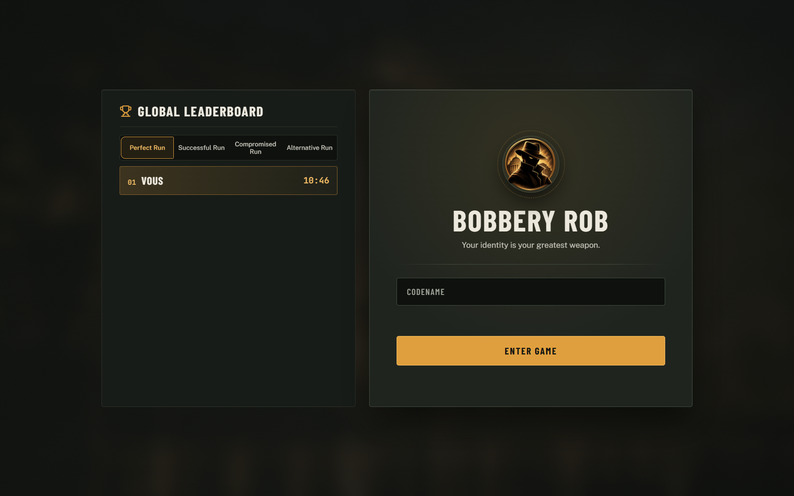
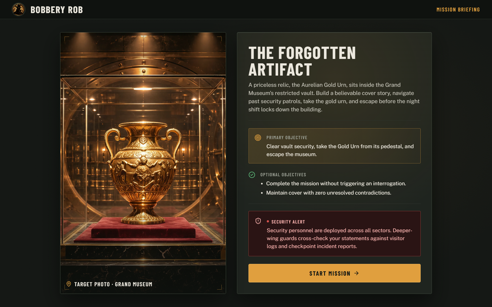
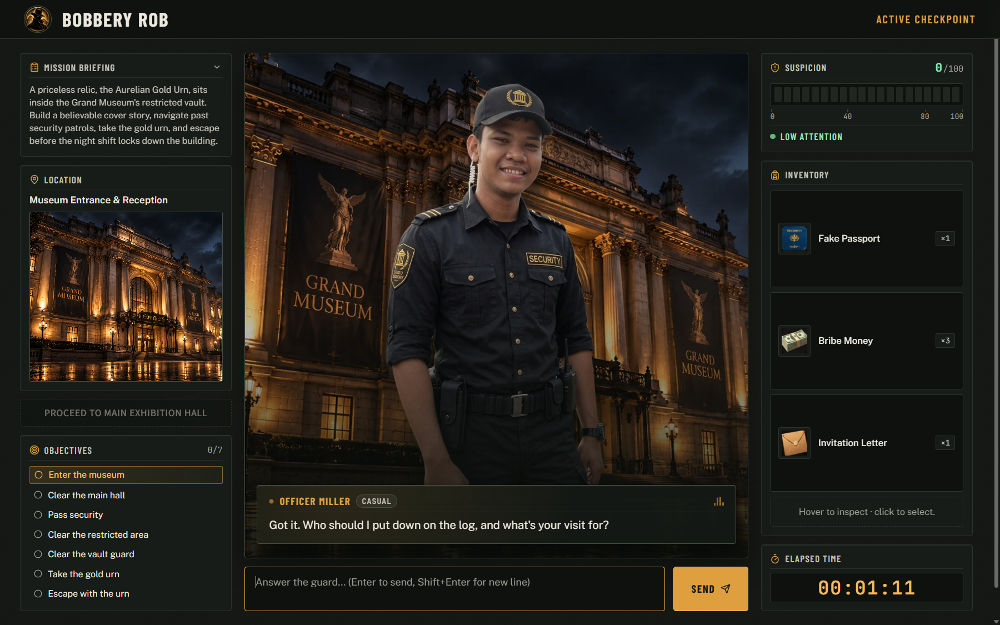

<div align="center">
  
  <h1>Bobbery Rob</h1>
  <p><strong>Your identity is your greatest weapon.</strong></p>
  <p>
    A single-player conversational social-deception game built with Python, Streamlit, and structured LLM reasoning.
    Infiltrate a museum after hours, invent a cover story on the fly, steal the Aurelian Gold Urn, and talk your way past exit security—without a conversation log to look back at.
  </p>

  <p>
    <a href="https://bobberyrob.streamlit.app">
      
    </a>
    
    
    
  </p>

  <p>
    <a href="#what-it-looks-like">What It Looks Like</a> •
    <a href="#how-the-game-works">How the Game Works</a> •
    <a href="#architecture">Architecture</a> •
    <a href="#local-setup">Local Setup</a> •
    <a href="#development--testing">Development</a>
  </p>
</div>

---

## Live Deployment

Play directly in your browser—no installation required:

> **Live App:** [https://bobberyrob.streamlit.app](https://bobberyrob.streamlit.app)

---

## What It Looks Like

Bobbery Rob uses a dark, anodized 1970s espionage debrief desk aesthetic built across four single-viewport desktop screens (**Main Menu → Mission Briefing → Active Checkpoint → Mission Debrief**), with responsive stacking on smaller screens.

### Main Menu & Global Leaderboard
Register a codename and browse the top 10 fastest adjusted times across all four ranked run categories.



### Mission Briefing
Review the dossier for *The Forgotten Artifact*, inspect the target photo of the Aurelian Gold Urn, check optional challenges, and start the mission clock.



### Active Checkpoint Gameplay
Gameplay preserves a 3-column operational desk layout:
- **Left — Mission Rail:** Collapsible mission briefing, current sector artwork, route progression trigger, and live 7-step objective checklist.
- **Center — Confrontation Stage:** Full-bleed museum backdrop, guard portrait & personality badge, active exchange transcript (current exchange only), and free-form text reply bar.
- **Right — Telemetry & Satchel:** Calibrated 20-segment VU suspicion meter (`0–100`), hover-to-inspect / click-to-present inventory, and live elapsed mission timer.



---

## How the Game Works

### The Mission: *The Forgotten Artifact*
The **Aurelian Gold Urn** sits inside the Grand Museum's restricted vault after closing. You have no pre-written disguise—you invent your own fictional identity through free-form conversation with six security officers as you work your way from reception to the vault, retrieve the urn, and bluff your way back out the front doors.

### Core Rules

1. **Invent and remember your cover story.**
   At reception, you establish your name, occupation, affiliation, and reason for visiting. Deeper-wing guards read visitor sign-in logs and shared checkpoint reports, then cross-examine you. **There is no chat history or identity sheet to look back at**—remembering your own lies is the challenge.
2. **Explicit corrections vs. silent contradictions.**
   New details, harmless paraphrases, and genuine self-corrections (*"Sorry, I meant..."*) are treated fairly. Silently contradicting an earlier claim triggers an **evidence-backed accusation** where the guard cites your exact earlier statement and demands an explanation.
3. **Suspicion and progression are tracked separately.**
   Keeping suspicion low does not automatically unlock doors—you must still satisfy each checkpoint's questioning and authorization checks. Conversely, rising suspicion intensifies guard scrutiny without wiping out completed objectives.
4. **Survive the Interrogation Room.**
   Pushing suspicion to `100`, getting caught bribing an honest officer, or presenting a counterfeit passport to an observant guard escalates you to the **Interrogation Room** with the **Chief Investigator**, who pulls your full recorded claim history. Explanations are evaluated as **Convincing** (`-10` suspicion, released), **Partially Convincing** (`+5` suspicion), or **Unconvincing** (`+20` suspicion and `+60s` penalty; failing final interrogation ends the run in capture).
5. **Taking the urn isn't the finish line.**
   Clearing the vault guard lets you take the Gold Urn from its pedestal (switching the vault scene to the empty glass case), which triggers the final confrontation at the **Exit Checkpoint**.

### Checkpoints & Guards

| # | Sector | Guard | Role | Personality & Focus |
| :-: | :--- | :--- | :--- | :--- |
| 1 | **Museum Entrance & Reception** | Officer Miller | Reception Desk Guard | **Casual** — Relaxed sign-in; logs your initial name and purpose. |
| 2 | **Main Exhibition Hall** | Officer Graves | Hallway Warden | **Strict** — Formal and by-the-book; rejects bribes outright and probes institutional details. |
| 3 | **Security Checkpoint** | Inspector Lin | Checkpoint Officer | **Observant** — Cross-checks logs, spots counterfeit watermarks, and requires physical authorization to enter restricted wings. |
| 4 | **Restricted Collection Area** | Chief Sterling | Archive Custodian | **Experienced** — 30-year veteran who cross-examines reception and checkpoint records. |
| 5 | **Vault Display Sanctum** | Officer Gomez | Vault Gatekeeper | **Impatient** — Hurried pre-lockdown guard who cuts off rambling and verifies vault clearance. |
| 6 | **Exit Checkpoint & Grand Foyer** | Captain Jun | Exit Shift Commander | **Observant** — Final departure sweep; cross-checks your entire story and satchel before unlocking the exit. |
| — | **Interrogation Room** | Chief Investigator | Interrogator Detective | **Relentless** — Pulls verbatim quotes from every checkpoint when you are detained. |

### Inventory & Route Choices

Hover any item in your satchel to inspect its details, then click to present it to the active guard. Effects depend on *who* you're facing:

| Item | Starting Qty | Best Used On | Risk / Notes |
| :--- | :-: | :--- | :--- |
| **Fake Passport** | `×1` | Officer Miller (`-10` suspicion) | Officer Graves logs the serial (`+5`). **Inspector Lin spots the counterfeit watermark (`+20` + immediate interrogation).** Also unlocks the Alternate Ending path. |
| **Bribe Money** | `×3` | Officer Miller (`-15`), Officer Gomez (`-15`) | **Triggers immediate interrogation** (`+25` to `+30` suspicion) if offered to Graves, Lin, Sterling, or Jun. |
| **Invitation Letter** | `×1` | Miller (`-10`), Graves (`-5`), Lin (`-10`), Jun (`-10`) | Embossed VIP gala invitation. Serves as clean physical authorization at Security Checkpoint. |
| **Access Card** | `×0` *(earned)* | Lin, Sterling, Gomez, Jun (`-10` suspicion) | Single-use Level-4 curator pass issued when you clear Security Checkpoint. |

> **Security Checkpoint Branch:** Verbal claims alone will not unlock the scanner at Security Checkpoint. You must either present your **Invitation Letter** or sign the **Night Curator Escort Log** (`+25s` time penalty). Your chosen authorization route is recorded and shapes exit questioning later.

### Suspicion Scale

| Range | Tier | Guard Behavior |
| :---: | :--- | :--- |
| `0–19` | **Low Attention** | Calm, conversational; accepts plausible statements. |
| `20–39` | **Moderate Attention** | Asks follow-up questions and verifies minor details. |
| `40–59` | **Increased Scrutiny** | Requests corroborating details and cross-references earlier claims. |
| `60–79` | **High Scrutiny** | Directly challenges inconsistencies and consults shared security logs; mandatory interrogation threshold. |
| `80–99` | **Imminent Detention** | High alert; suspicion recovery from explanations or items is halved. |
| `100` | **Interrogation Triggered** | Immediate lockdown and formal final interrogation. |

### Endings & Leaderboard Scoring

| Ending | Leaderboard Category | How to Reach It |
| :--- | :--- | :--- |
| **Perfect Infiltration** | `Perfect Run` | Take the urn & escape with suspicion `≤ 30`, `0` interrogations, and `0` unresolved contradictions. |
| **Successful Infiltration** | `Successful Run` | Take the urn & escape with suspicion `≤ 65` and at most `1` interrogation. |
| **Compromised Victory** | `Compromised Run` | Take the urn & escape under heavy heat (suspicion `66–99` or multiple interrogations). |
| **Alternate Ending: Academic Discovery** | `Alternative Run` | Use the **Fake Passport**, reach the **Restricted Collection Area** with suspicion `< 50`, and choose voluntary scholarly exit. |
| **Capture / Failure** | *Unranked* | Fail formal interrogation. |

- **Optional Challenges:** *Ghost Operative* (`0` interrogations) and *Silver Tongue* (`0` unresolved contradictions).
- **Adjusted Time Formula:** `Adjusted Time = Raw Gameplay Time + Penalties`
  - Night Curator Escort Log: `+25s`
  - Contradiction Penalty / Failed Access Penalty: `+30s`
  - Unconvincing Explanation Penalty: `+60s`
- **Privacy & Persistence:** Only codenames and completed-run statistics are stored in SQLite (`database/bobbery_rob.db`). Dialogue transcripts and identity claims live strictly in session memory and are never saved to the database.

---

## Architecture

**The AI interprets; the deterministic Python engine decides.**

```text
Player message / Item click
        │
        ▼
┌───────────────────┐     Structured JSON (Call A: analysis / Call C: evaluation)
│  Streamlit UI     │ ◄──► ┌──────────────────────────┐ ──► LLM Client (OpenAI SDK / Mock)
│  (app, screens)   │      │  Deterministic Engine    │ ◄── Guard Dialogue (Call B)
└───────────────────┘      │  (game/, memory/, rules) │
                           └────────────┬─────────────┘
                                        │
                      ┌─────────────────┴─────────────────┐
                      ▼                                   ▼
            Scenario Config (JSON)               Leaderboard (SQLite)
```

- **Engine authority:** A guard's generated dialogue can never grant an item, unlock a room, alter suspicion, or end a run on its own.
- **Grounded evidence:** Contradictions are verified against verbatim archived player turns (`memory/`) before a guard is allowed to accuse you.
- **Resilient LLM budget:** Live calls share a 20-second per-turn wait budget with strict JSON Schema validation and neutral, zero-penalty fallbacks if a request times out.
- **Prompt-injection defense:** Deterministic guards block system-prompt tampering and roleplay breakouts before they can manipulate game state.

---

## Local Setup

### Prerequisites
- **Python 3.12** (tested and recommended)
- **Git**
- *(Optional)* An OpenAI API key or OpenAI-compatible endpoint key for live AI dialogue

### 1. Clone the repository

```sh
git clone https://github.com/DanielMarkA/BobberyRob.git
cd BobberyRob
```

### 2. Create and activate a virtual environment

```sh
python -m venv .venv
```

- **Windows (PowerShell):**
  ```powershell
  .\.venv\Scripts\Activate.ps1
  ```
- **macOS / Linux:**
  ```sh
  source .venv/bin/activate
  ```

### 3. Install dependencies

```sh
python -m pip install -r requirements.txt
```

### 4. Configure live AI dialogue *(optional)*

No API key is required just to launch the app and explore the UI—without one, Bobbery Rob falls back to an offline mock guard (great for testing screens and item actions, though not representative of real free-form questioning).

For live gameplay, create `.streamlit/secrets.toml` (gitignored) or export the same names as environment variables:

```toml
OPENAI_API_KEY = "your-api-key"

# Optional: override the model ID (default: gpt-6-luna)
# BOBBERY_LLM_MODEL = "your-model-id"

# Optional: use an OpenAI-compatible provider (switches to /chat/completions)
# OPENAI_BASE_URL = "https://your-provider.example/v1"
```

### 5. Run the app

```sh
python -m streamlit run app.py
```

Open the local URL printed in your terminal (default `http://localhost:8501`), enter a codename, and click **Start mission**.

---

## Development & Testing

### Project Structure

| Path | Responsibility |
| :--- | :--- |
| [app.py](app.py), [screens/](screens/), [ui/](ui/) | Streamlit entrypoint, 4 screens, custom CSS/JS interactions, and UI components |
| [game/](game/) | Deterministic engine: suspicion math, interrogation lifecycle, inventory, routes, and endings |
| [scenario/museum.json](scenario/museum.json), [scenario/loader.py](scenario/loader.py) | Scenario data (locations, guards, items, thresholds, objectives, endings) and typed loader |
| [llm/](llm/) | OpenAI Responses / Chat Completions client, strict JSON schemas, prompts, 20s turn budget, and mock client |
| [memory/](memory/) | Verbatim turn archive, claim & correction tracking, guard visibility scoping, and shared reports |
| [database/](database/) | SQLite schema, codename registration, completed run storage, and leaderboard queries |
| [static/](static/) | Custom museum artwork, guard portraits, inventory art, SVG icons, and self-hosted fonts |
| [tests/](tests/) | Unit tests and 13 scripted conversation regression scenarios |
| [docs/](docs/) | Presentation walkthrough ([demo_script.md](docs/demo_script.md)), balance guide ([playtest.md](docs/playtest.md)), and README screenshots |

### Environment Variables

| Variable | Purpose |
| :--- | :--- |
| `OPENAI_API_KEY` | API key for live LLM analysis and guard dialogue. |
| `BOBBERY_LLM_MODEL` | Override default model (`gpt-6-luna`). |
| `OPENAI_BASE_URL` | Base URL for OpenAI-compatible endpoints. |
| `BOBBERY_LLM_MOCK=1` | Force offline mock mode even when an API key is configured. |
| `BOBBERY_DEV_SHORTCUTS=1` | Show a **Dev shortcuts** expander on gameplay to preview result endings. |
| `BOBBERY_FAST_TRANSITIONS=1` | Skip the 2-second auto-advance pause between cleared checkpoints. |

### Test Suites & CLI Tools

Run both offline suites from the repository root:

```sh
python -m unittest discover
python -m tests.run_conversations
```

Exercise the LLM interface directly from the terminal:

```sh
python -m llm.try_it "I'm Dr. Vance, here for the gala collection review." --mock
```

### Additional Resources
- **Live presentation walkthrough:** [docs/demo_script.md](docs/demo_script.md)
- **Playtesting & balance guide:** [docs/playtest.md](docs/playtest.md)
- **Memory model details:** [memory/README.md](memory/README.md)
- **Optional audio asset generator:** [scripts/generate_audio.py](scripts/generate_audio.py) *(the playable web build ships without WAV audio)*
